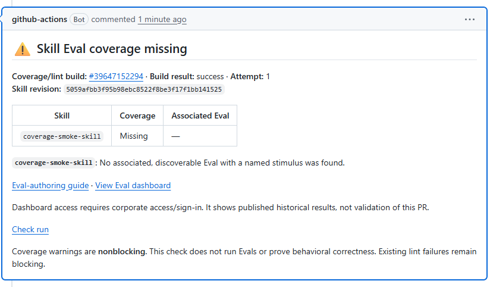
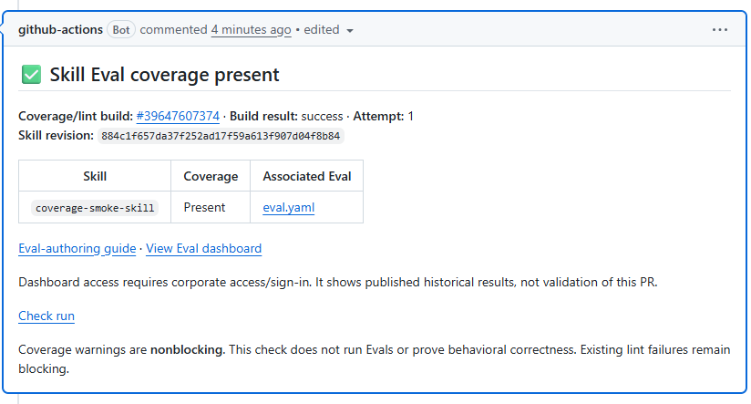
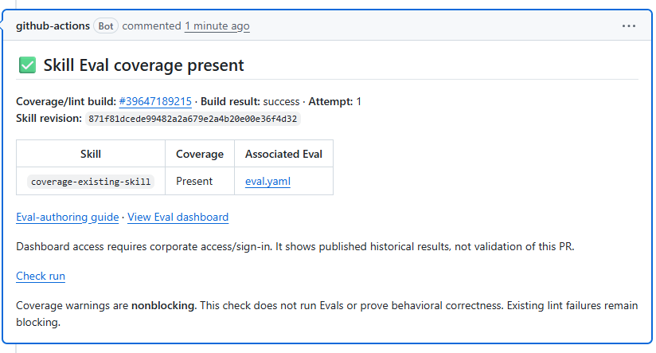

# Live skill coverage tests — 21 October 2026

Source draft: [Azure/azure-sdk-tools#17345](https://github.com/Azure/azure-sdk-tools/pull/17345), revision d4e1569c79840a9fd1045498654522da8f991c8f.

All screenshots are captures of actual public GitHub bot comments, not reconstructed UI. The checker, trusted reporter, and both workflows were copied byte-for-byte from the source revision. Only the personal fork's synthetic discovery configuration and skill fixtures differ.

| Test | Change | Expected and observed | Source run | Trusted reporter | Comment |
| --- | --- | --- | --- | --- | --- |
| 1 | New skill, no Eval | Coverage missing, one nonblocking warning; source coverage/lint succeeded; one bot comment | [39647152294](https://github.com/helen229/azure-sdk-tools/actions/runs/39647152294) | [39647271439](https://github.com/helen229/azure-sdk-tools/actions/runs/39647271439) | [6322718736](https://github.com/helen229/azure-sdk-tools/pull/2#issuecomment-6322718736) |
| 2 | Add that skill's starter Eval | Coverage present, zero warnings; same comment updated, no duplicate | [39647607374](https://github.com/helen229/azure-sdk-tools/actions/runs/39647607374) | [39647717854](https://github.com/helen229/azure-sdk-tools/actions/runs/39647717854) | [Same comment](https://github.com/helen229/azure-sdk-tools/pull/2#issuecomment-6322718736) |
| 3 | Edit only an existing skill definition | Workflow automatically triggered; coverage present, zero warnings; baseline Eval blob unchanged; new PR receives a comment | [39647189215](https://github.com/helen229/azure-sdk-tools/actions/runs/39647189215) | [39647298570](https://github.com/helen229/azure-sdk-tools/actions/runs/39647298570) | [6322722083](https://github.com/helen229/azure-sdk-tools/pull/3#issuecomment-6322722083) |

Each real comment contains current coverage, coverage/lint build ID/result/attempt/revision, authoring guide, and the historical Eval dashboard link. Test 1's comment has subsequently been updated by Test 2; the Test 1 screenshot and saved comment preserve the original warning result.

## Test 1 screenshot

## Test 2 screenshot

## Test 3 screenshot

## Cleanup verification

All three hosted runs executed 75 deterministic checker/reporting tests. Fake test scenarios produced zero warning annotations; only Test 1's real skill warning was present. A regression executes the reporter tests under GitHub Actions variables and verifies an unchanged summary sentinel and no workflow commands. Local combined checker/shared tests: 149 passed, no failures or skips.

## Limits and restoration

These are GitHub coverage/static-lint runs, not model-backed Eval or Azure DevOps builds. No Evals, Azure resources, dashboard uploads, or deployments were executed. Same-repository bot delivery is verified; contributor-fork permissions and all source-PR CI checks are not established by these tests. The original fork default was restored to main, and its original main commit and Actions/token policies were verified unchanged. Both source and test PRs remain drafts and unmerged.
